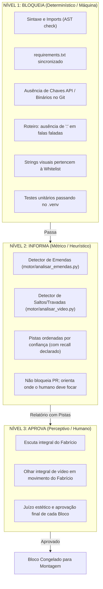

# Sistema de Supervisão e Aprendizado Contínuo de Orquestração (SI-LS)
*Self-Improvement Based Learning Supervision*  
**Autor & Gestor:** Antigravity (Gestor de Playbook e Otimização de Orquestração)  
**Projeto:** Frila Video Pitch (`FrilaApp/frila-video-pitch`)

---

## 1. O que é o SI-LS?
O **SI-LS** é a camada de governança e metassupervisão do pipeline de agentes do Maestri. Seu objetivo é substituir a especulação e tentativa-e-erro por **iterações baseadas em dados empíricos observados diretamente nas sessões dos modelos** (Claude Code e Codexes).

```
   ┌────────────────────────────────────────────────────────┐
   │ 1. Telemetria & Sessões Reais (Maestri / Worktrees)    │
   └───────────────────────────┬────────────────────────────┘
                               ▼
   ┌────────────────────────────────────────────────────────┐
   │ 2. Inquérito Complementar e Estruturado (Antigravity) │
   └───────────────────────────┬────────────────────────────┘
                               ▼
   ┌────────────────────────────────────────────────────────┐
   │ 3. Logs de Feedback & Taxonomia de Falhas (docs/logs)  │
   └───────────────────────────┬────────────────────────────┘
                               ▼
   ┌────────────────────────────────────────────────────────┐
   │ 4. Engenharia de Mitigação: Hooks, Scripts & Playbook  │
   └────────────────────────────────────────────────────────┘
```

---

## 2. A Política dos Três Níveis de Gates

Uma das principais fontes de paralisia e falso atrito identificada nos modelos foi a confusão entre o que constitui **erro técnico impeditivo** e o que constitui **pista heurística para refinamento perceptivo**. O Playbook agora adota a separação estrita em três níveis:



---

## 3. Taxonomia de Incidentes e Mitigações

| Categoria | Definição | Exemplo Observado | Mecanismo de Prevenção |
|---|---|---|---|
| **F1: Environment Parity** | Divergência entre pacotes ou interpretador do worktree vs raiz | `cv2`/`Pillow` rodando em miniconda local e quebrando no `.venv` raiz | `scripts/verificar.sh`, `scripts/check_dependencies.py`, `scripts/worktree.sh` |
| **F2: Copy Hallucination** | Invenção de texto em UI, legendas ou telas sem fonte real | *"A confirmação encerra a ação."* inserido em mockup de cena | `scripts/lint_copy.py` cruzando contra `roteiro.json` e `docs/v4/` |
| **F3: Metric Confusion** | Tratar heurísticas incipientes como árbitros finais de qualidade | 69 suspeitas na v5 travando o Engenheiro de Áudio sem confirmação real | Política dos Três Níveis + declaração obrigatória de recall |
| **F4: Script Breakdown** | Execução parcial de scripts de automação gerando commits corrompidos | Script de docs do Maestro falhando na metade no PR #5 | Verificação atômica de saída em scripts e `pre-pr-check.sh` |
| **F5: Provenance Break** | Fatiamento posterior de áudios contínuos de bloco gerando corte de frase | Frase fatiada entre tomada contínua e música de fundo | Regra A1/A8 + registro de hashes e offsets de amostras |

---

## 4. Ciclo de Retroalimentação Periódica

A cada marco ou entrega de Bloco (A, B, C, D):
1. **Disparo do Inquérito:** Antigravity dispara perguntas complementares aos agentes ativos via `maestri ask --batch`.
2. **Log de Feedback:** Registro em `docs/orquestracao/logs/YYYY-MM-DD-sessao-XX.json`.
3. **Auditoria de Regras:** Ajustes no `PLAYBOOK.md` e em `role.json`.
4. **Endurecimento de Tooling:** Criação/atualização de linters e hooks de verificação.
